<div align="center">



<br/>


<a href="https://huggingface.co/pavankumarbalijepalli"></a>
<a href="https://instagram.com/bunnybethinking"></a>
<a href="https://www.linkedin.com/in/pavan-kumar-balijepalli/"></a>
<a href="https://github.com/pavankumarbalijepalli/connect-with-me"></a>

</div>

<br/>

## hey, I'm Bunny.

Pavan on paper. I'm a **Lead Data Scientist / AI Lead at Cigna**, seven-plus years into AI/ML, and I've stopped thinking of "data science" and "AI engineering" as separate jobs. A model that never leaves a notebook doesn't help anyone, so most of my time goes into the unglamorous middle: turning a promising experiment into something that survives real traffic, real data drift, and real users who don't read the docs.

Lately that means a lot of **agentic systems**: LLMs that don't just answer, but plan, call tools, and know when to ask for help instead of guessing. On the side I'm doing an **M.Tech in AI/ML at BITS Pilani** (most recently: ResNet50 transfer learning on chest X-rays for the Deep Neural Networks course), and guest lecturing there too.

<table align="center">
<tr>
<td width="33%" valign="top">

**Machine Learning & AI**
<br/>
<sub>Model development, experimentation, and evaluation, built for the use case in front of me, not the leaderboard.</sub>

</td>
<td width="33%" valign="top">

**Data Science Practice**
<br/>
<sub>Data prep, feature engineering, and predictive analytics that earn their place in a pipeline.</sub>

</td>
<td width="33%" valign="top">

**Production-minded AI**
<br/>
<sub>Fewer moving parts, more uptime. If it can't be explained simply, it probably can't be maintained either.</sub>

</td>
</tr>
</table>

---

## what I'm digging into



Most of my day-to-day is applied: shipping systems, not training foundation models. But I've been pulling back toward the fundamentals: how LLMs are actually pretrained, the architecture and optimization choices underneath the abstractions I usually work above. You can't reason well about agentic systems, fine-tuning, or failure modes if you've only ever met a model as a black box behind an API.

Some of that shows up on [Hugging Face](https://huggingface.co/pavankumarbalijepalli):

| model | what it is |
| :-- | :-- |
| **TeLLM** | a Telugu LLM |
| **phi2-sqlcoder** | Phi-2, fine-tuned to turn plain English into SQL |

---

## bunnybethinking

> *be the mentor I never had.*

I run **[bunnybethinking](https://instagram.com/bunnybethinking)**, AI/ML content for people who feel like outsiders in AI. Most AI content either talks down to beginners or talks past them. I'm building something in between, for people who are curious, a little overwhelmed, and tired of feeling like they showed up late. I'd rather build a **village** than an audience. No-filter, comfortable being wrong, allergic to hype.

```text
┌────────────────────────────┬────────────────────────────┐
│ 01  ABCs of AI             │ 02  Pin it or Bin it       │
│ fundamentals, explained    │ news + papers: worth       │
│ like you're a person       │ keeping, or not?           │
├────────────────────────────┼────────────────────────────┤
│ 03  What I Tested          │ 04  What I'm Learning      │
│ this week's experiments,   │ learning in public,        │
│ wins and flops             │ wrong answers included     │
├────────────────────────────┼────────────────────────────┤
│ 05  Career tips            │ 06  Personal stories       │
│ the stuff nobody           │ the long way round,        │
│ tells you upfront          │ told honestly              │
├────────────────────────────┼────────────────────────────┤
│ 07  Reddit painpoints      │ 08  AI/Human Interactions  │
│ what people are actually   │ where people and models    │
│ stuck on, answered         │ meet, and get weird        │
└────────────────────────────┴────────────────────────────┘
```

YouTube is home base, with quick hits on Instagram and LinkedIn. First up on YouTube: **"How I Finally Became Consistent Learning AI (4 Things I Had to Unlearn)."** Fair warning, it's about the thing I'm still working on.

---

## teaching at BITS Pilani (WILP)

I guest lecture on **Agentic AI**, **Conversational AI**, and **LLMs**, and teach NLP Applications sessions: spell and grammar checking, QA, RAG, conversational AI, sentiment, privacy and ethics, machine translation, neural MT, and MT for Indic languages.

```text
  no slides. one whiteboard. first principles.

  [ topic ] ──> what breaks? ──> [ next topic ] ──> what breaks? ──> ...

  e.g.   machine translation
               │  what breaks?
               ▼
         neural MT
               │  what breaks for Telugu, Hindi, ...?
               ▼
         MT for Indic languages
```

Explaining a system out loud is the fastest way to find the part you don't actually understand yet, so the teaching feeds straight back into how I build.

---

## the long way here

```text
  applications ████████████████████████████████████████  200+
  interviews   ███████░░░░░░░░░░░░░░░░░░░░░░░░░░░░░░░░░  37
  the one      █░░░░░░░░░░░░░░░░░░░░░░░░░░░░░░░░░░░░░░░  1  <- Lead DS / AI Lead
```

Before this role: 200+ applications and 37 interviews. If you're in the middle of your own version of that chart, keep going. The bar on the bottom only needs to fill once.

---

## what I'm building: [KUWT](https://github.com/pavankumarbalijepalli/kuwt)

> **KUWT** is an AI-powered content generation automation platform, built to keep technology enthusiasts and learners current with what's actually happening in AI, without the noise.

---

## tools I reach for

<div align="center">


<br/>


</div>

---

## the numbers

<p align="center">
  <a href="https://github.com/pavankumarbalijepalli?tab=repositories">
    
  </a>
  &nbsp;
  <a href="https://github.com/pavankumarbalijepalli?tab=achievements">
    
  </a>
</p>

<p align="center">
  <a href="https://git.io/streak-stats">
    
  </a>
</p>

---

<div align="center">



### let's talk

Raise an issue on [connect-with-me](https://github.com/pavankumarbalijepalli/connect-with-me), find me on [LinkedIn](https://www.linkedin.com/in/pavan-kumar-balijepalli/), or come hang out at [bunnybethinking](https://instagram.com/bunnybethinking).


<sub>art is hand-built ASCII, animated with CSS. regenerate with <code>python3 assets/generate.py</code></sub>

</div>
