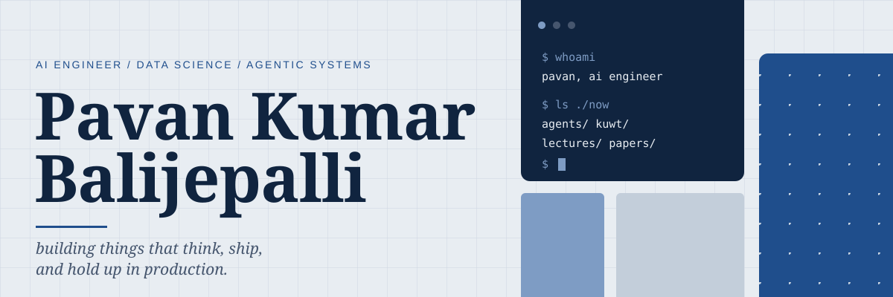

<div align="center">



<br/>


<br/>
<br/>

<a href="https://www.linkedin.com/in/pavan-kumar-balijepalli/"></a>
<a href="https://instagram.com/bunnybethinking"></a>
<a href="https://github.com/pavankumarbalijepalli/kuwt"></a>
<a href="https://github.com/pavankumarbalijepalli/connect-with-me"></a>

</div>

<br/>

<div align="center">

```text
 ██████╗  █████╗ ██╗   ██╗ █████╗ ███╗   ██╗
 ██╔══██╗██╔══██╗██║   ██║██╔══██╗████╗  ██║
 ██████╔╝███████║██║   ██║███████║██╔██╗ ██║
 ██╔═══╝ ██╔══██║╚██╗ ██╔╝██╔══██║██║╚██╗██║
 ██║     ██║  ██║ ╚████╔╝ ██║  ██║██║ ╚████║
 ╚═╝     ╚═╝  ╚═╝  ╚═══╝  ╚═╝  ╚═╝╚═╝  ╚═══╝

   (\_/)     .---------------------------------------.
   (o.o)  o  |  no-filter. comfortable being wrong.  |
   (> <)     |  allergic to hype.                    |
             '---------------------------------------'
```

</div>

<br/>

```text
pavan@bunnybethinking:~$ cat status.txt

  role ......... AI Engineer, 7+ years (data science -> agentic AI)
  building ..... KUWT, AI-powered content automation
  teaching ..... BITS Pilani WILP: Agentic AI, Conversational AI, LLMs
  reading ...... how LLMs are actually pretrained
  running ...... bunnybethinking, a village figuring this out together
  rule #1 ...... fewer moving parts, more uptime

pavan@bunnybethinking:~$ _
```

---

## The short version

Seven-plus years in, I've stopped thinking of "data science" and "AI engineering" as separate jobs. A model that never leaves a notebook doesn't help anyone, so most of my time goes into the unglamorous middle: turning a promising experiment into something that survives real traffic, real data drift, and real users who don't read the docs.

Lately that means a lot of **agentic systems**: LLMs that don't just answer, but plan, call tools, and know when to ask for help instead of guessing. I also spend a good chunk of time on the teaching side of this, guest lecturing on Agentic AI, Conversational AI, and LLMs, because explaining a system out loud is the fastest way to find the part you don't actually understand yet.

<br/>

<table align="center">
<tr>
<td width="33%" valign="top">

**Machine Learning & AI**
<br/>
<sub>Model development, experimentation, and evaluation, built for the use case in front of me, not the leaderboard.</sub>

</td>
<td width="33%" valign="top">

**Data Science Practice**
<br/>
<sub>Data prep, feature engineering, and predictive analytics that earn their place in a pipeline.</sub>

</td>
<td width="33%" valign="top">

**Production-minded AI**
<br/>
<sub>Fewer moving parts, more uptime. If it can't be explained simply, it probably can't be maintained either.</sub>

</td>
</tr>
</table>

---

## What I'm building: [KUWT](https://github.com/pavankumarbalijepalli/kuwt)

> **KUWT** is an AI-powered content generation automation platform, built to keep technology enthusiasts and learners current with what's actually happening in AI, without the noise.

```text
   sources          agents            you
  ┌────────┐      ┌─────────┐      ┌─────────┐
  │ the    │ ───> │ filter  │ ───> │ signal, │
  │ noise  │      │ + write │      │ no hype │
  └────────┘      └─────────┘      └─────────┘
```

---

## Outside the day job: [bunnybethinking](https://instagram.com/bunnybethinking)

I run **bunnybethinking**, an AI/ML content brand built around a simple idea: be the mentor I never had when I was starting out. Most AI content online either talks down to beginners or talks past them. I'm trying to build something in between, aimed at people who are curious, a little overwhelmed, and tired of feeling like an outsider in this space.

It shows up as fundamentals breakdowns, weekly paper reads, "what I tested this week" experiments, and painpoints pulled straight from what people are actually asking on Reddit. Not a course funnel, just a village of people figuring this out together. No-filter, comfortable being wrong, allergic to hype.

```text
  ┌────────────────────────────────────────────────────────────┐
  │  fundamentals breakdowns  ->  the ABCs of AI               │
  │  weekly paper reads       ->  one paper, plain words       │
  │  what I tested this week  ->  experiments, wins and flops  │
  │  painpoints from Reddit   ->  what people actually ask     │
  └────────────────────────────────────────────────────────────┘
```

---

## What I'm digging into right now

Most of my day-to-day is applied: shipping systems, not training foundation models. But I've been pulling back toward the fundamentals lately: how LLMs are actually pretrained, the architecture and optimization choices underneath the abstractions I usually work above. It's partly curiosity, partly the belief that you can't reason well about agentic systems, fine-tuning, or failure modes if you've only ever worked with a model as a black box behind an API.

---

## Guest Lecturer: BITS Pilani (WILP)

I guest lecture on **Agentic AI**, **Conversational AI**, and **LLMs** at BITS Pilani's Work Integrated Learning Programmes. I like teaching this stuff for a selfish reason too: explaining a system out loud is the fastest way to find the part you don't actually understand yet, so it feeds back into how I build.

---

## Tools I reach for

<div align="center">


<br/>


</div>

---

## The numbers

<p align="center">
  <a href="https://github.com/pavankumarbalijepalli?tab=repositories">
    
  </a>
  &nbsp;
  <a href="https://github.com/pavankumarbalijepalli?tab=achievements">
    
  </a>
</p>

<p align="center">
  <a href="https://git.io/streak-stats">
    
  </a>
</p>

---

<div align="center">

## Let's talk

Follow along, raise an issue on my [connect-with-me](https://github.com/pavankumarbalijepalli/connect-with-me) repo, or find me on [LinkedIn](https://www.linkedin.com/in/pavan-kumar-balijepalli/).

```text
                 N
                 ^
                 |
          W <----+----> E
                 |
                 v
                 S

   ~~  ~   ~~~   ~~    ~    ~~~   ~~   ~    ~~~  ~~
 ~   ~~~   ~~  ~    ~~~  ~~    ~   ~~~   ~~   ~    ~
        analog in a digital life.
        a chart drawn at sea.
```


</div>
